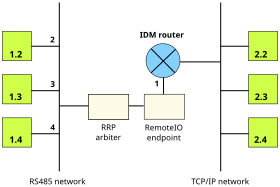

Overview
========

Here we will use the RS-485 demo box: thre Arduinos, each one with a
push button and a led, connected to others using a RS-485 bus through a
transceiver, and a RS-485 to USB adapter connected to the PC.

On each Arduino, there is an Object adapter (using the **icec-rrp
endpoint**) with a servant to control the light (implements a
`DUO.IBool.W`). Besides, when the push button is pressed, it will send a
message (`DUO.IBool.W.set`) to a server on the PC.

On the PC side, there are three nodes written in Python that listen on
a **TCP/IP endpoint**. Each one implements the `DUO.IBool.W`
interface. Moreover, a client could also be used to send messages to
every node in the IDM network (either to the PC servers or to the
Arduinos).

The IDM addressing scheme is 16 bit length, with a netmask of 8
bits. The Ice Identity specifies each byte in its decimal notation,
separated by a dot, much like IPv4. Examples: `1.2`, `192.50` or
`254.1`. The address `0.0` has a special meaning depending on context, 
it usually means "no address" and should not be assinged to a node.

Programming the Arduinos
========================

**Note**: the arduinos are connected to the PC using the serial devices
`/dev/ttyUSB0` to `/dev/ttyUSB2`.

There are three Arduinos, each one with different **IDM** and **RRP
addresses**, but all share the same source code. In order to program
just one node, specify the node addres on make command:

    $ make compile upload ADDR=2

This will give the node the IDM address: 1.2, and the RRP addres:
2. To upload the code to all nodes at once, use the following:

    $ make upload-all

Launching the PC servers
========================

If you want to launch only one server, run this:

    $ ./server.py <addr>

where `<addr>` should be the IDM addres on the PC side (the network
part of the address is 2). Examples of addresses are 2.2 or 2.254. If
you want to launch all the servers at once, use the script called
`launch-servers.sh`. This will run each server on a different terminal
window (provided that you have `xterm` installed). The optional
`offset` param is used to set the `geometry` argument to put the
window on the screen.

    $ ./launch-servers.sh [offset]

Running the Router
==================

**Note**: the router needs a RS-485 to USB adapter connected to
 `/dev/ttyUSB3`.

The router needs two elements to work. The first is the RRP
arbiter. To launch it, just type (remember to install all `DEPENDS`
packages):

    $ rrp-shell --daemon --ice-iface --Ice.Config=/usr/share/rrp/rrp-shell.config

Now, you are ready to run the router, using the following command:

    $ ./router.py

Sending messages
================

You can send messages to every node in the IDM network.

From the Arduinos
-----------------

Each Arduino node has a _harcoded_ destination address (given by a
small table in the source code). When someone presses the push button, it
sends the internal switch state to its destination. So, just press the
push button!

From the PC side
----------------

To send a message from the PC, you could use the client
provided. Unlike the Arduinos, the PC client can send a message to
every other node, doesn't matter if the destination is a PC server or
an Arduino one. To use the client, run:

    $ ./client.py <addr>

The addr param is an IDM address, like `1.2` or `2.4`.
